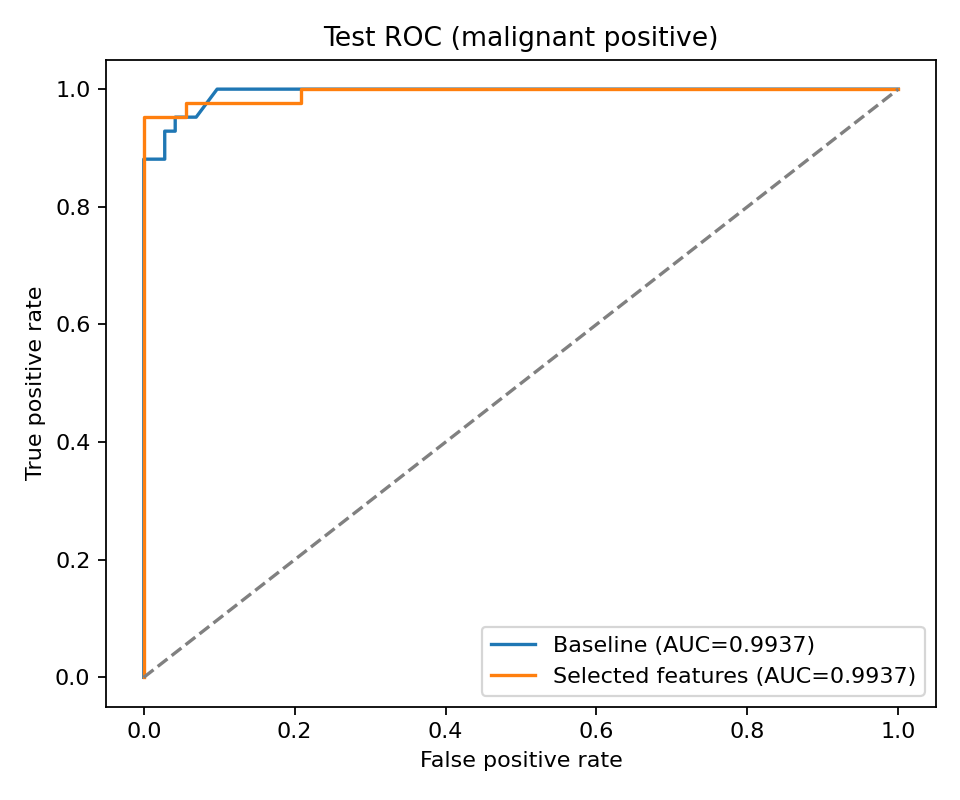
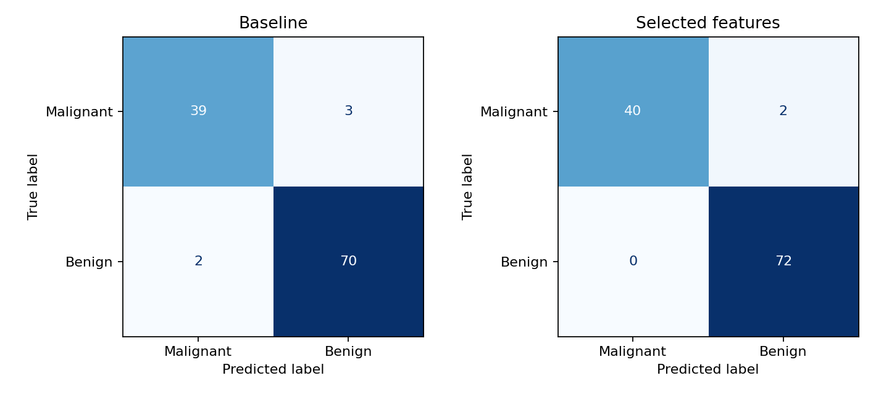
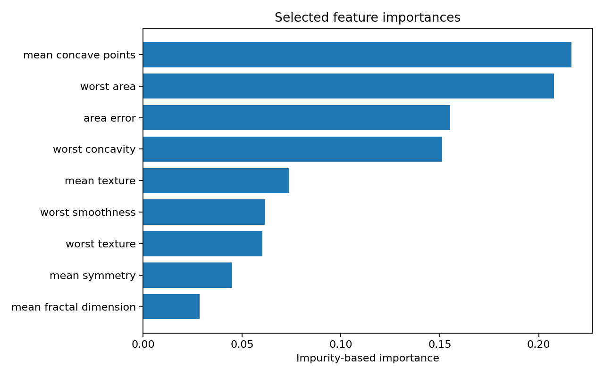

# Breast Cancer Classification & ML Optimization

An educational machine learning project combining Random Forest classification with a custom genetic algorithm (GA) for feature selection and hyperparameter optimization on the Wisconsin Diagnostic Breast Cancer dataset.

## Reproduced results (v2)

Both models were retrained using the original stratified 80/20 split (seed 42, 455 training and 114 test samples). The optimized configuration is the **saved winner from the original experiment**, not a newly completed full GA search.

| Metric | Baseline RF | GA-selected RF |
|---|---:|---:|
| Test accuracy | 95.61% | 98.25% |
| ROC-AUC | 0.9937 | 0.9937 |
| Precision (malignant) | 95.12% | 100.00% |
| Recall (malignant) | 92.86% | 95.24% |
| F1 (malignant) | 93.98% | 97.56% |
| Input features | 30 | 9 |
| Misclassified test samples | 5 | 2 |

The observed improvement is 2.64 percentage points in accuracy, with 70% fewer features. ROC-AUC is unchanged. The dataset encodes malignant as 0 and benign as 1; all class-specific metrics and ROC plots here treat malignancy as positive. These are results on a single, previously inspected split, not independent external validation.







## Methodology

- Load the 569 samples and 30 numeric features provided by scikit-learn.
- Reserve a stratified 20% test partition.
- Search feature masks and five Random Forest hyperparameters using only the training partition and shuffled stratified five-fold cross-validation.
- Use tournament selection, two-point crossover, mutation and elitism.
- Compare a default Random Forest against the selected configuration on the test partition.

The original fitness objective is preserved:

`fitness = 0.7 * mean_cv_auc + 0.3 * mean_cv_accuracy - 0.02 * selected_features / 30`

Default GA settings: population 50, 20 generations, individual mutation probability 0.05, per-feature mutation probability 0.02, crossover probability 0.9, two elites, seed 42.

## What's new in v2

- Reusable Python module and command-line runner, separate from the notebook.
- Compute both CV metrics in one `cross_validate` call instead of fitting each fold twice.
- Cache repeated chromosomes; surface training errors instead of silently replacing scores with zeros.
- Reproduce the original saved configuration and export actual metrics and plots.
- Add four automated tests, including a reduced-budget GA smoke test.
- Preserve the original notebook, report and documentation in `legacy/` without altering their contents.

The smoke search (4 individuals, 2 generations) produced 8 cache hits and 4 unique evaluations out of 12 fitness requests. These correspond to 20 CV fits versus up to 120 in the original uncached two-pass method for the same number of requests (theoretical fit count, not a measured full-search speedup). The full 50 × 20 search has **not** been rerun in v2; its runtime and final result have not been validated here.

## Getting started

Tested with Python 3.13.5 and scikit-learn 1.8.0 in the current environment. From the repository root:

```bash
python -m venv .venv
```

Activate the environment (Windows PowerShell: `.venv\Scripts\Activate.ps1`; macOS/Linux: `source .venv/bin/activate`), then:

```bash
python -m pip install -r requirements.txt
python run_experiment.py
python -m pytest -q
```

Open `experiment_v2.ipynb` in Jupyter for a walkthrough. The default run reproduces the saved configuration; it does not run the full GA.

Optional fresh search:

```bash
python run_experiment.py --search --population 4 --generations 2
python run_experiment.py --search --population 50 --generations 20 --jobs 2
```

Search outputs go to `results/search/` by default, so they do not overwrite the reproduced results. A full search may take substantial CPU time. For a new scientific study, predefine the protocol and avoid selecting configurations based on test results.

## Repository structure

```text
src/experiment.py       Dataset, GA and evaluation functions
run_experiment.py       Reproduction and search CLI
experiment_v2.ipynb    Research walkthrough
results/                Reproduced metrics, figures and GA smoke log
tests/                  Regression and smoke tests
legacy/                 Original artifacts (unchanged contents)
requirements.txt        Dependency versions
```

## Limitations and next steps

- The same original holdout was used for reproduction; nested CV or an independent dataset is needed for stronger generalization evidence.
- The original GA selected both features and hyperparameters, so the observed gain cannot be attributed solely to feature selection. Add a controlled ablation study.
- Impurity-based feature importance is not a causal explanation.
- The original full search was not independently rerun. The original PDF is archived as received, not audited.
- This is an educational research project, not a clinically validated diagnostic tool. Do not use it for medical decisions.

## Author

Yousef Hossam | AI Engineering & Data Analysis

[GitHub](https://github.com/usiif11) · [LinkedIn](https://www.linkedin.com/in/yousef-hossam-63b167358)
